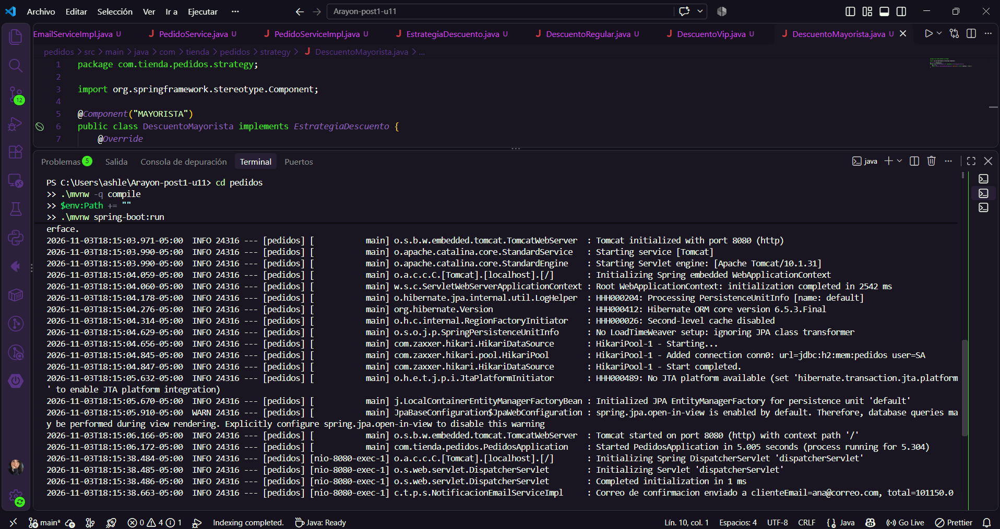
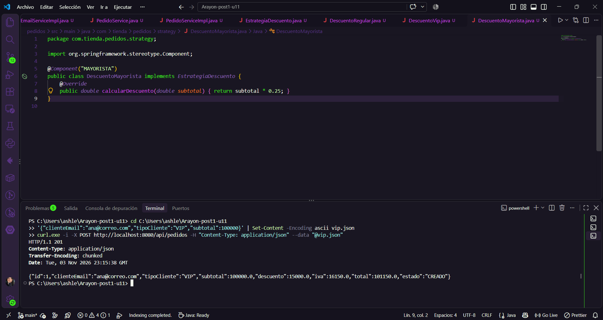
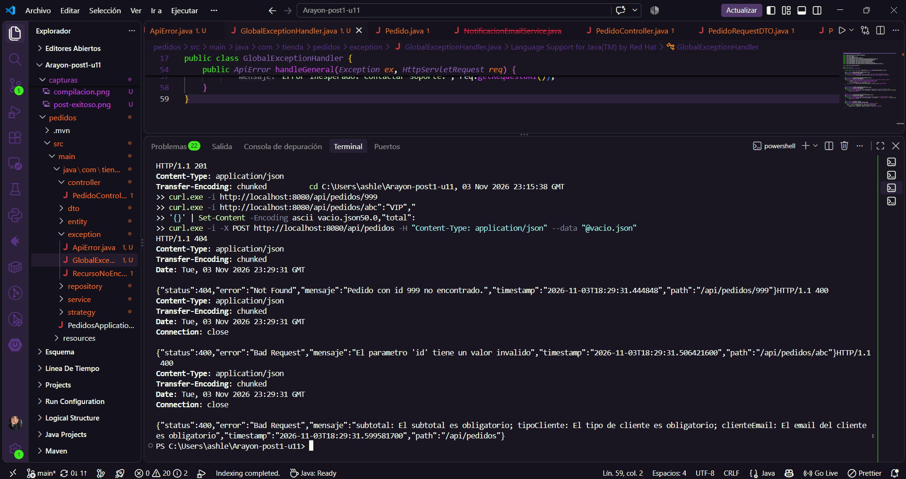
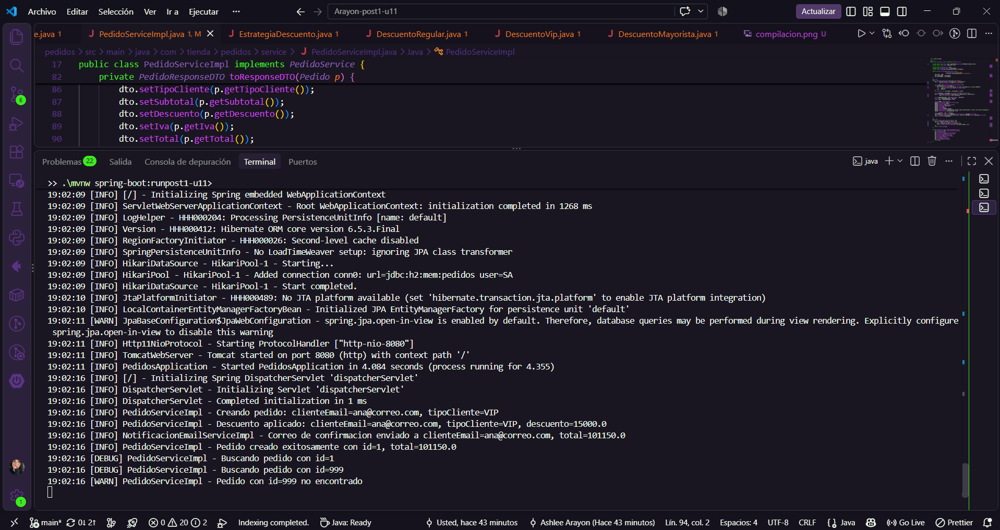
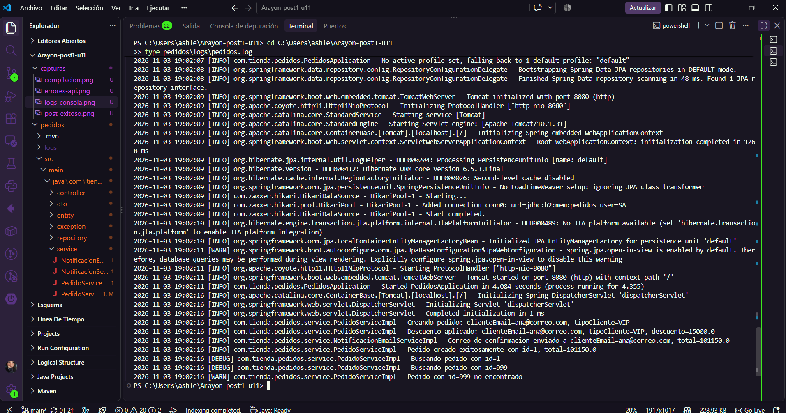
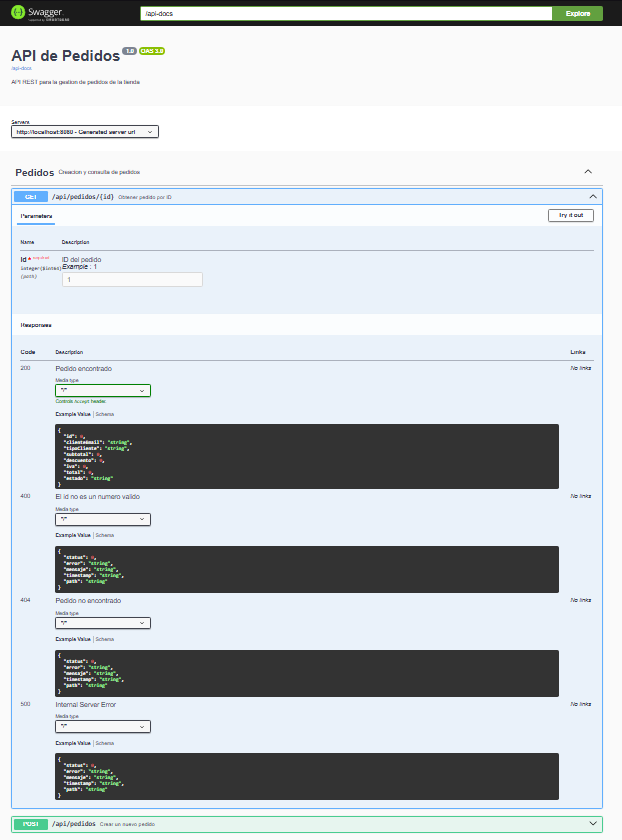

# Post-contenido — Unidad 11: Buenas Prácticas y Patrones de Diseño

Laboratorio de Programación Web (Séptimo Semestre). Un único proyecto Maven Spring Boot
(`pedidos/`, paquete `com.tienda.pedidos`) que parte de un código mal diseñado y lo
refactoriza con arquitectura en capas, DTO, inyección por constructor y Strategy. En la
Parte 2 se endurece con manejo centralizado de errores, logging y Swagger.

## Arquitectura resultante

```
Cliente HTTP
    |
PedidoController  (controller/)     recibe PedidoRequestDTO, devuelve PedidoResponseDTO
    |
PedidoService  <<interfaz>>  (service/)
    |
PedidoServiceImpl                   orquesta: descuento, IVA, persistencia, notificacion
    |-- Map<String, EstrategiaDescuento>   (strategy/) DescuentoRegular / Vip / Mayorista
    |-- NotificacionService <<interfaz>>   -> NotificacionEmailServiceImpl
    |-- PedidoRepository  (repository/)    extiende JpaRepository
            |
        Pedido (entity/)

GlobalExceptionHandler + ApiError (exception/): errores 404 / 400 / 500
```

## Violaciones del código de partida y cómo se corrigieron

| Violación | Corrección |
|---|---|
| **SRP:** `crearPedido` validaba, calculaba, persistía, notificaba y registraba | Cada responsabilidad en su clase: DTO valida, Strategy calcula, repositorio persiste, `NotificacionService` notifica |
| **DIP:** `new NotificacionEmailService()` en el controller | Interfaz `NotificacionService` inyectada por constructor |
| **SQL embebido y concatenado** (inyección SQL) | `PedidoRepository` con Spring Data JPA, sin SQL a mano |
| **Entidad expuesta** (filtraba `notasInternas`) | `PedidoRequestDTO` / `PedidoResponseDTO` con mapeo explícito |
| **Errores silenciados:** `try/catch` con `println` y `null` (200 vacío) | `RecursoNoEncontradoException` y `GlobalExceptionHandler` (404 con `ApiError`) |
| **`System.out.println` como log** | SLF4J con niveles y placeholders |

## Parte 1: Refactorización
Commits: proyecto base, código de partida (el "antes" queda en el historial), DTOs y repositorio, servicio con DIP, Strategy.




## Parte 2: Errores, logging y documentación





## Decisiones de diseño
**Parte 1**
- **Strategy y no un segundo patrón (Factory) para el DTO:** el descuento tiene variación real (un tipo nuevo solo exige una clase nueva, OCP); el mapeo entidad-DTO es 1:1 y se resuelve con un método privado, sin sobre-ingeniería.
- **`JpaRepository` en lugar de `JdbcTemplate`:** elimina el SQL concatenado y da consultas derivadas con seguridad de tipos.

**Parte 2**
- **El log del descuento vive en el servicio**, no en cada Strategy: un único punto de auditoría por pedido.
- **`notasInternas` nunca se registra en logs ni se expone en el DTO.**

## Decisiones propias (ajustes al material base)
- **Spring Boot 3.3.5:** start.spring.io ofreció 4.x, incompatible con el código de la guía.
- **`@NotNull` en `subtotal`:** evita un `NullPointerException` si el campo no viene.
- **Tipo de cliente desconocido** se normaliza a `REGULAR` (con `log.warn`) en vez de guardarse tal cual.
- **`NotificacionEmailServiceImpl` usa SLF4J**, no `println`: cero `System.out.println` en el proyecto.
- **`ApiError`** con constructor de 4 argumentos y timestamp automático (el enunciado declaraba 5 campos y lo construía con 4).
- **Handlers extra:** JSON malformado y id no numérico responden 400 (daban 500); el handler genérico registra con `log.error`.
- **Patrón de log** `[%level] Clase - mensaje`, como pide el checkpoint.
- **`@ApiResponse` con esquema `ApiError`** para 400 y 404 en Swagger.
- **`double` para montos:** se mantiene por coherencia con el enunciado; para dinero real convendría `BigDecimal`.

## Cómo compilar y ejecutar
1. Clonar el repositorio.
2. `cd pedidos` y `./mvnw spring-boot:run` (H2 en memoria).
3. Probar en `http://localhost:8080/api/pedidos` (POST con JSON, GET por id).
4. Logs en consola y en `pedidos/logs/pedidos.log` (ignorado por git).
5. Swagger UI: `http://localhost:8080/swagger-ui.html`